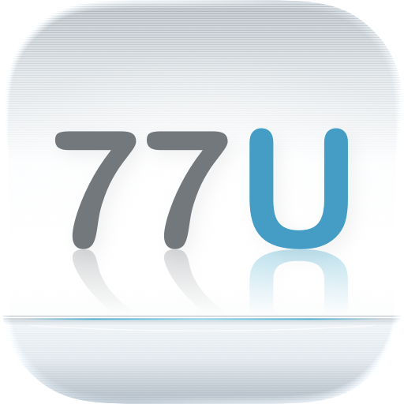

  

<h1 align="center">77U</h1>

A Wii U emulator for iPhone and iPad, based on Cemu and rendering with Metal.

  <a href="https://github.com/77emul/77U-BETA/releases/latest">Download</a> ·
  <a href="CHANGES.md">Changelog</a> ·
  <a href="BUILD.md">Build from source</a>

## Requirements

- iOS or iPadOS 26 or later
- A device with 8 GB of RAM is recommended. Compatibility and performance vary
  by game and device.

## Getting started

1. Download the IPA from the latest release and sign it with a sideloading
   tool. Enable Developer Mode if iOS asks for it.
2. Open **Add games** and pick an extracted Wii U game folder, or a WUA, WUD or
   WUX file dumped from your own console.
3. Select a game and tap **Play**. Games run with the interpreter by default.
   For JIT, open **Settings > JIT activation** and follow the pairing file and
   LocalDevVPN steps.

The app ships without games, firmware, console keys or model weights.

## Features

- Metal renderer with per-game Cemu graphic packs, resolution presets, FPS++
  and optional frame generation
- Bluetooth controllers, editable touch controls and motion input
- TV and GamePad layouts and external display support
- Game library with covers, updates and DLC
- Save export and restore, and online play through Pretendo with files from
  your own console

## Reporting bugs

[Open an issue](https://github.com/77emul/77U-BETA/issues/new) with your device
model, OS version, game and game version, JIT mode, and steps to reproduce.
Keep pairing files, console keys and account details out of public logs.

## License

77U is a modified version of [Cemu](https://github.com/cemu-project/Cemu).

- Source code is licensed under the Mozilla Public License 2.0
  ([LICENSE.txt](LICENSE.txt)) unless a file states otherwise.
- The JIT scripts in `dependencies/StikJIT/Resources` come from
  [StikDebug](https://github.com/StikDebug/StikDebug) and are licensed under the
  GNU AGPL 3.0 ([LICENSE-AGPL-3.0.txt](LICENSE-AGPL-3.0.txt)).
- Binary releases include those scripts and are distributed as a combined work
  under the AGPL 3.0. Each release links its complete source.
- Third-party components keep their own licenses. See
  `platform/ipados/Resources/Licenses`.

77U is an independent project and is not affiliated with or endorsed by
Nintendo or the Cemu project. Wii U is a trademark of Nintendo.

## Credits

[Cemu](https://github.com/cemu-project/Cemu),
[StikDebug and StikJIT](https://github.com/StikDebug),
[idevice](https://github.com/jkcoxson/idevice) and
[Pretendo](https://pretendo.network).

[Discord](https://discord.gg/ZaqGfVYPB) · [TikTok](https://www.tiktok.com/@77emul)
